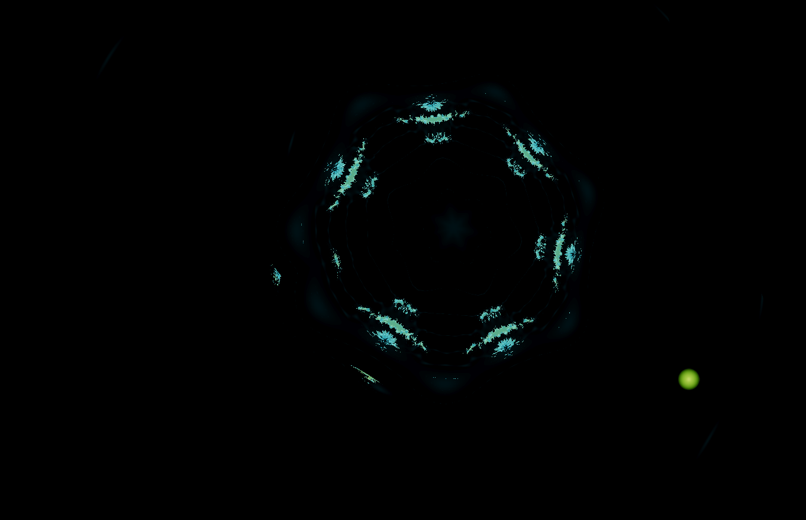
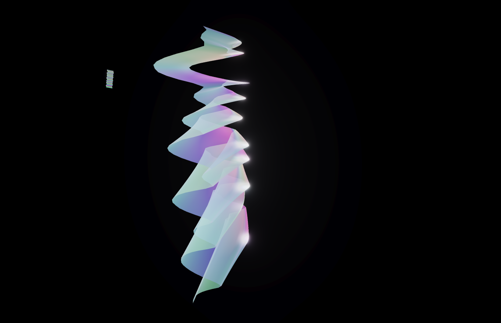
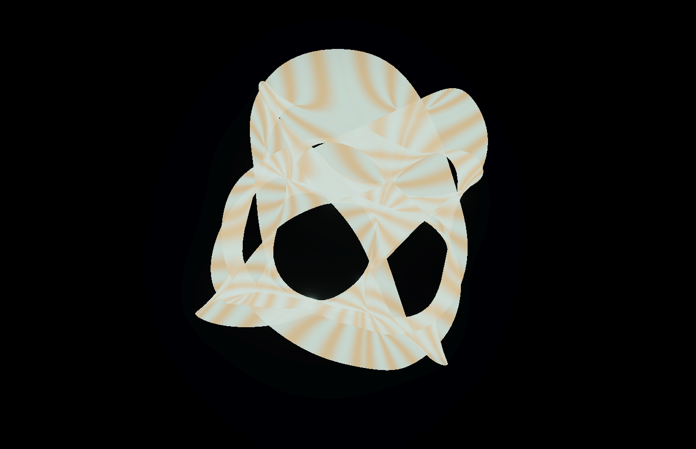

# Math Cosmos · 数学宇宙

[](https://threejs.org/)
[](https://www.typescriptlang.org/)
[](https://vite.dev/)

**40 类数学模型、114 个实体、1 座黎曼猜想巨构，装进一个可 6DoF 飞行的 WebGL 宇宙。**

Lorenz 吸引子、Calabi–Yau 流形、Mandelbulb、E8 根系、Zeta 零点螺旋……每类模型都按自身数学结构驱动几何与着色器；各实体沿开普勒轨道自主巡游，拥有独立的游荡与对玩家的好奇/恐惧反应；音效、相机、巨兽与星尘全部实时程序化生成，不使用预渲染动画。单击任意模型即可展开公式图鉴。

## 预览

| 分形 | 数论 | 拓扑 |
|:--:|:--:|:--:|
|  |  |  |
| M07 Mandelbulb | M35 Zeta 零点 | M04 Calabi–Yau |

以上图像取自 `tests/visual-baseline/`，同时是视觉回归的对照基准。

## 快速开始

需要 Node.js 18+。

```bash
npm install
npm run dev
```

打开 http://localhost:5173/ 进入宣传主页，点击任意位置或「进入宇宙」进入主体验；也可直接访问 http://localhost:5173/app.html 。首次点击画布或按键会解锁程序化音频。

### 宣传主页

站点根 `/` 是 Apple 风格的单页入口：首屏正中央实时渲染 M35 黎曼 ζ 临界带曲面（复用主程序的几何与着色器），点击任意位置即可跃迁进入 `app.html` 主体验。生产构建产出 `dist/index.html`（宣传页）与 `dist/app.html`（主程序），两者共享 three 分包，入口脚本体积分别受 `check:bundle` 预算约束。

宣传页支持中文 / English / 日本語 / 한국어 / Deutsch / Français / Русский 七种语言：首次访问按系统语言自动选择（不支持的语言回退英文），也可用导航右侧的地球按钮手动切换；手动选择会写入 `localStorage`，之后优先于系统语言。

## 操作

| 输入 | 行为 |
|---|---|
| 单击画布空白处 | 进入鼠标捕获（Pointer Lock） |
| 移动鼠标 | 俯仰 / 偏航 |
| 按住左键拖动 | 未锁定时以拖动代替鼠标视角 |
| `W` / `S` | 前进 / 后退 |
| `A` / `D` | 左 / 右平移 |
| `Space` / `Ctrl` | 上升 / 下降 |
| `Q` / `E` | 左 / 右滚转 |
| 按住 `Shift` | 曲速（同时提升极速、推力并降低阻尼） |
| 单击模型 | 打开该模型的公式图鉴（KaTeX） |
| `Esc` | 释放鼠标 |
| 右上角按钮 | 跃迁至黎曼巨构 / 数学模型索引 / 音效开关 |

## 命令

| 命令 | 说明 |
|---|---|
| `npm run dev` | 启动开发服务器 |
| `npm run preview` | 预览生产构建 |
| `npm run typecheck` | TypeScript 严格检查 |
| `npm test` | Vitest（纯数学 / 单元 / 集成） |
| `npm run build` | 类型检查 + 生产构建 |
| `npm run ci` | typecheck + vitest + build + 分包预算 |
| `npm run check:bundle` | 单独校验入口与总 JS 体积预算 |
| `npm run verify:ego` | 场景冒烟门禁（需 dev server + ego-browser） |
| `npm run verify:resources` | 资源释放审计（需 dev server + ego-browser） |
| `npm run verify:perf` | 性能门禁（需 dev server + ego-browser） |
| `npm run capture:visual` | 生成 40 类当前截图到 `tests/visual-current`（需 dev server） |
| `npm run update:visual` | 显式更新 `tests/visual-baseline` |
| `npm run compare:visual` | 对比当前截图与视觉基线（需 python3 + Pillow） |

## 规模

- **40 类模型，114 个实体**，编号覆盖 M01–M40。
- **三环壳层**：内环 31 / 中环 65 / 外环 18。
- 每类模型具备 LOD0 / LOD1 / LOD2 三级；实体随距离自动换级，分帧延迟初始化。
- 分类枚举：`number-theory / chaos / topology / fractal / analysis / physics / high-dim / pde`。
- 音频按 `audioFamily`（`chaos / topology / high-dim / fractal / quantum`）选择音色，与视觉分类解耦。

| 壳层 | 主题 | 模型 |
|---|---|---|
| 内环 | 数论 / 量子朝圣带 | M10 M11 M12 M26 M27 M28 M32 M35 M38 M40 |
| 中环 | 混沌 / 拓扑洋流带 | M01 M02 M03 M04 M05 M06 M09 M13 M14 M15 M16 M17 M18 M19 M20 M21 M30 M33 M34 M36 M39 |
| 外环 | 分形 / 深空边疆带 | M07 M08 M22 M23 M24 M25 M29 M31 M37 |

## 架构

```
main.ts → CosmosApp（Engine + WorldContext + SystemRunner + UI）
                    ↓ 固定顺序，不可交换
  leviathan → navigation → dust → creatures → lod → callout → audio → hud
```

- 逐帧逻辑由 8 个 System 组成，`SystemRunner` 固定顺序调度并记录逐系统 EMA 耗时。
- `FlightController` 为状态机门面，内部拆分 `ManualPilot` / `WarpPilot` / `OrbitEscort`。
- 模型统一走 `CreatureFactory` + 40 条蓝图注册表，材质由 `CreatureMaterialFactory` 收敛。
- `ResourceTracker` 统一登记与释放几何、材质、纹理。

详见 [ARCHITECTURE.md](./ARCHITECTURE.md) 与 [Docs/IMPLEMENTATION_STATUS.md](<Docs/IMPLEMENTATION_STATUS.md>)。

## 目录结构

```
src/
  main.ts               bootstrap
  app/                  场景编排、跨系统上下文、事件契约
  core/                 Engine、SystemRunner、飞控、轨道、资源、性能探针
  systems/              8 个逐帧系统
  entities/             实体基类、工厂、巨兽、LOD、行为层、40 类模型
  audio/                音频门面、声部池、多普勒、空间混音
  data/                 40 条模型蓝图、图鉴数据、黎曼证明图
  shaders/              GLSL、chunk 与模板
  ui/                   HUD、图鉴抽屉、跃迁索引、输入
scripts/                EGO 门禁、视觉基线、分包预算检查
tests/                  单元/集成测试、场景基线、性能预算、视觉基线
Docs/                   三卷图鉴、数据结构规范、行为层与音频规格
```

## 性能预算

预算定义在 `tests/perf-budget.json`，由 `npm run check:bundle` 与 `npm run verify:perf` 执行。

| 指标 | 预算 |
|---|---|
| 入口 JS | ≤ 700 KB |
| 总 JS | ≤ 1.25 MB |
| DrawCall | ≤ 160 |
| 三角形 | ≤ 1.2M |
| CPU 更新 | ≤ 1.5 ms/帧（200 次批量均摊） |
| 运行时错误 | 0 |

## 测试与门禁

`npm run ci` 是纯 Node 门禁，不需要浏览器：`tsc --noEmit` → `vitest run` → `vite build` → 分包预算。

运行时门禁依赖 `ego-browser` CLI 提供的浏览器运行环境（经 `ego-browser nodejs` 执行 `scripts/*.js`），需先启动 dev server：

```bash
npm run dev            # 另一个终端
npm run verify:ego     # 114 个体 / 40 类 / M01–M40 / 三环 31-65-18 / LOD / DrawCall / 三角形 / 系统数 / 0 错误
npm run verify:resources
npm run verify:perf
```

地址可用 `COSMOS_URL` 覆盖，例如 `COSMOS_URL=http://localhost:4173/ npm run verify:ego`。冒烟脚本通过 `window.__COSMOS__` 读取场景状态，改动系统注册表或壳层分配时需同步更新期望值。

视觉回归：默认只写当前截图，避免静默覆写基准。

```bash
npm run capture:visual   # 写入 tests/visual-current
npm run compare:visual   # 当前 vs tests/visual-baseline
```

对比脚本要求 40 张截图与 `manifest.json` 齐全并逐张过阈值，缺失或超阈值即失败。确认画面变更符合预期后，才显式执行 `npm run update:visual` 更新基线。

## 文档

- [实现状态（代码口径）](<Docs/IMPLEMENTATION_STATUS.md>)
- [技术架构与全模型可视化方案](<Docs/3D 数学宇宙（Math Cosmos）技术架构与全模型可视化开发方案.md>)
- [扩展图鉴 Vol.1：16 种高阶模型与 GLSL 方案](<Docs/3D 数学宇宙扩展图鉴：16 种高阶数学模型公式与 GLSL 着色器技术方案.md>)
- [扩展图鉴 Vol.2：M29–M40 公式与可视化方案](<Docs/3D 数学宇宙扩展图鉴 Vol.2：12 种高阶数学模型公式与可视化方案（M29–M40）.md>)
- [全量模型与黎曼猜想数据结构规范](<Docs/3D 数学宇宙：全量模型与黎曼猜想数据结构规范（Data Structures & GPU Memory Schema）.md>)
- [6DoF 飞船动力学与程序化空间音频规格](<Docs/3D 数学宇宙：6DoF 飞船物理动力学与程序化空间音频合成规格说明书.md>)
- [全模型自主行动与黎曼威慑龙行为层规格](<Docs/3D 数学宇宙：全模型自主行动与黎曼威慑龙行为层规格方案.md>)
- [黎曼巨兽莫比乌斯巡游与星群公转动力学规格](<Docs/3D 数学宇宙：黎曼巨兽莫比乌斯仿生巡游与天体群星公转动力学规格方案.md>)

## 已知边界

- Costa 曲面、准晶体、庞加莱球、E8 投影等为保留辨识度的近似几何，非闭式精确网格。
- `verify:perf` 在无头软件渲染下约 30 FPS 属正常，真实 GPU 帧率未纳入门禁。
- 各图鉴卷的壳层半径表述早于代码，实际口径以 `Docs/IMPLEMENTATION_STATUS.md` 与 `tests/perf-budget.json` 为准。
